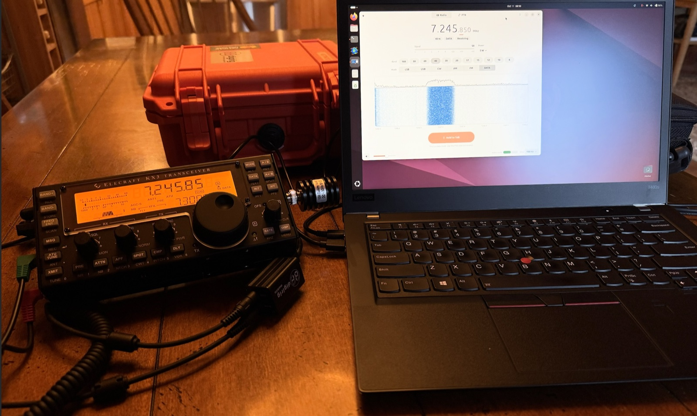
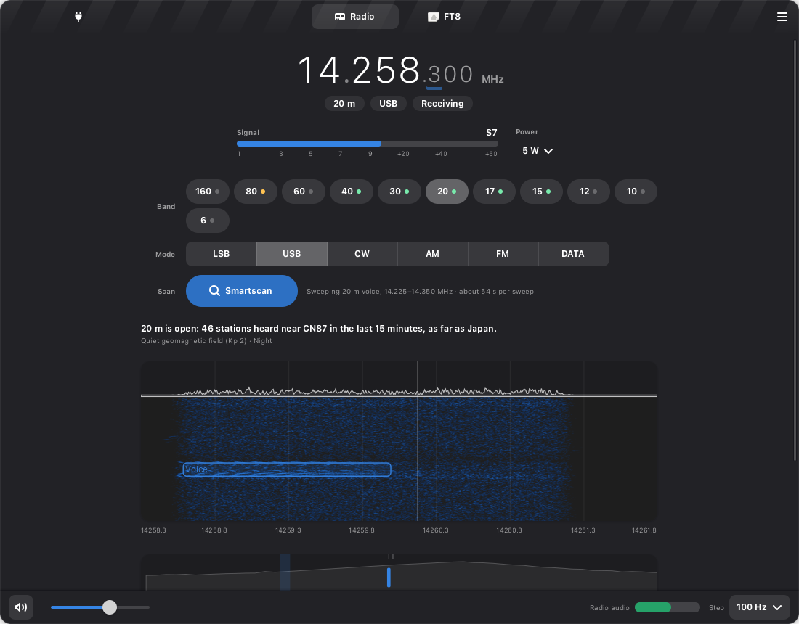
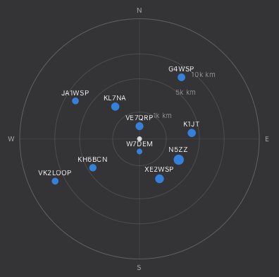
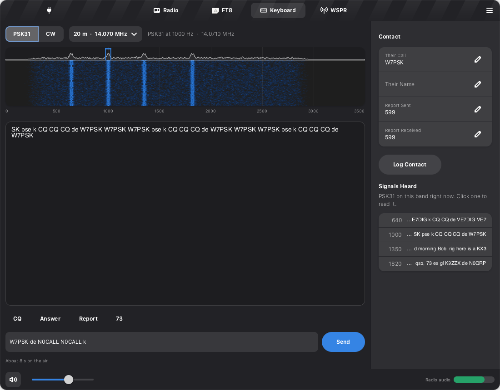
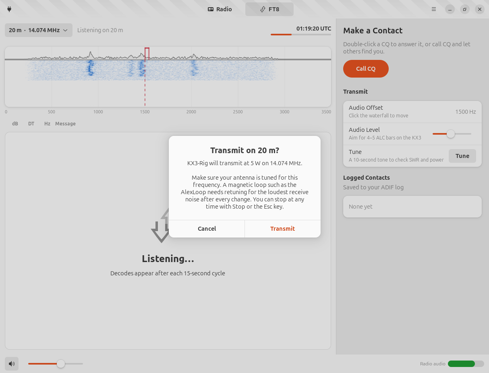

# KX3-Rig

A friendly controller for the **Elecraft KX3**, made for the GNOME desktop. Plug in the radio,
open the app, and start tuning. KX3-Rig shows a big tunable frequency, the band around you as a
waterfall, lets you listen and talk through your computer, runs FT8 and FT4 contacts for you,
reads and sends PSK31 and CW, and maps who hears you on WSPR.



It is built for one station today: an Elecraft KX3 connected to an Ubuntu laptop through a
**Digirig Mobile** and the Elecraft KX cable set, with a magnetic loop antenna.

<p align="center"></p>

## Why this exists

KX3-Rig is based on WSJT-X, WSJT-X Improved, Hamlib 4.5.5, fldigi, Elecraft's documentation, and
other existing tools and sources, listed under "What KX3-Rig reuses" below. It doesn't do
anything new; it is just very customized to one station and one operator's UI opinions: an
Elecraft KX3, a Digirig, and an AlexLoop antenna.

Anyone can use or fork this repo, and with gear like this it should work out of the box. Where
it shines is as a starting point for **agentic coding**. The repo carries the reference material
and the rules a coding agent needs to change a radio app safely:

- sourced radio facts in [docs/references.md](docs/references.md)
- transmit safety rules and conventions in [CLAUDE.md](CLAUDE.md)
- an emulator good enough to run the whole app without a radio

What KX3-Rig reuses (kept current: each new source a feature borrows from is added here, and
cited in [docs/references.md](docs/references.md)):

- **WSJT-X**: its `jt9` decoder and `ft8code` encoder run as programs. The FT8 waveform, dial
  frequencies, and contact sequencing and logging rules follow its source and User Guide.
- **Hamlib 4.5.5**: read, not linked. It cross-checks the CAT commands, supplies the S-meter
  calibration, and showed the `K22` state that KX3-Rig restores on exit.
- **Elecraft's documents**: the KX3 Owner's Manual, its errata, the Programmer's Reference, and
  the KXAT3 instructions.
- **AlexLoop know-how**: the manufacturer's archived tuning procedure, VE3WDM's bandwidth
  measurements, AD5X's review, and two decades of operators' notes on the Elecraft list and
  QRP blogs, for Loop Tune.
- **The rules and the band plan**: 47 CFR Part 97 for license privileges, and the ARRL band plan
  and published QRP calling frequencies for where Smartscan listens.
- **PSKReporter and NOAA SWPC**: live band conditions for Smartscan.
- **WSJT-X Improved** (DG2YCB): ideas, not code. Keeping a fading contact alive, the Armed
  warning, decode filters, callsigns on the waterfall, and the SWR stop.
- **fldigi and G3PLX's PSK31 specification**: the Varicode table, PSK31 shaping, and the CW
  decoder's design, for the Keyboard view.

While this agent-aware repo is great for customizing setups similar to mine, the magic trick
is to do something like this in a Claude Code CLI session with Opus 5.5 and xhigh reasoning:

```text
Make a new project forking https://www.github.com/peterzat/KX3-Rig
and matching the rig I run in FCC Grid FN31:
a <large computer controllable transceiver>,
with a <typical 100W amplifier for that transceiver>,
and a <suitable antenna setup>
```

And you'd expect to one-shot a working solution. Why? Because this is an
[agent-first repo](https://agent-hypervisor.ai/posts/agent-first-repos/#fork-and-customize): its
end state, rules, and verification travel with the fork, so the agentic pattern acts as a live
and near [oracle-level](https://agent-hypervisor.ai/posts/bitter-lesson-of-agentic-coding/#what-i-think-is-durable)
spec for your own radio setup, even if it's quite different from my KX3.

## Make it yours

Want a quick-bar setting, a different band plan, or support for your antenna? Describe it to
Claude Code, then test it on your own equipment and local conditions. The development setup
(spec, code review, and security review skills, plus conventions) is
[zat.env](https://github.com/peterzat/zat.env).

[Smartscan](docs/smartscan.md) and [Loop Tune](docs/looptune.md) were built this way on
purpose: personal features, start to end, because we can. Smartscan hunts the band for someone
to talk to. Loop Tune guides the AlexLoop's tuning procedure and quietly says when it is due.
Each was researched from sources, designed around this station's rules, and verified against
the emulator, both in a single Claude Code session.

<p align="center"></p>

The idea behind it is [The Bitter Lesson of Agentic Coding](https://agent-hypervisor.ai/posts/bitter-lesson-of-agentic-coding/):
"Define what done looks like. Let the model figure out how to get there. Build the simplest
harness that verifies the work." Here the harness is the references, the rules, and the
emulator, so repurposing the app for a different station takes a few different paragraphs of
intent. It also means a polished, professional-looking app can exist for an audience of one: a
really custom ham shack, and anyone can have their own. How Smartscan and Loop Tune were built
is in [docs/custom-shack.md](docs/custom-shack.md).

## What it does

- **Tune** with a large frequency display. Scroll or drag over any digit to tune that digit,
  click a digit to make it the tuning step, use the arrow keys, or just type a frequency.
- **Pick a band and mode** with one click. Band buttons use the KX3's own band memory, so the
  radio returns to where you last were on each band.
- **See the band** on a waterfall of the receiver's passband, labeled in real frequencies.
- **Listen** on the laptop speakers or a headset. (With the Digirig plugged into PHONES the
  KX3's own speaker is silent, so the app plays the radio for you.)
- **Talk** with Hold to Talk, using the computer's microphone, in SSB, AM, or FM.
- **Smartscan** the band: one click sweeps your voice (or CW) segment, outlines stations on the
  waterfall, keeps a few seconds of each to replay, and marks which bands are open from your grid
  square right now. Click a station to listen. See [docs/smartscan.md](docs/smartscan.md).
- **Tune the loop**: a guide for the AlexLoop. It peaks the loop on receive noise with a live
  meter, then checks it with a short, low-power TUNE that you key on the radio. A small tag
  under the frequency turns amber when you have moved far enough, or changed band, to need it
  again. See [docs/looptune.md](docs/looptune.md).
- **Work FT8 or FT4**: one click sets the radio up, decodes appear every period, and
  double-clicking a CQ runs the whole contact and logs it in ADIF.
  - Each decode shows distance and direction, and a New tag marks stations not in your log.
  - Callsigns sit over the waterfall where they were heard; double-click one to answer.
  - Filters hide doubtful decodes, logged stations, or everything but CQs.
  - A contact that fades waits a few minutes for the other station and picks up if they come
    back.
- **Keyboard: PSK31 and CW**, read and typed on the computer. Click a signal to read it. Every
  PSK31 signal on the band is listed with its latest text. Macros fill in the calls, and
  contacts go to the same log.
- **WSPR**: hear who is on the air and see them on a map by direction and distance. Run a beacon
  for a set time to find out how well the loop gets out (see who heard you on wsprnet.org).
- **Stop on high SWR**: when the KX3 reports SWR above 2.5:1 during a transmission, KX3-Rig stops
  and offers Loop Tune. This needs KX3 firmware 2.93 or later.
- See [docs/digital-modes.md](docs/digital-modes.md) for how the new modes work and why.
- **Stay legal**: transmit is limited to your license class's privileges (set your callsign,
  grid, and class in Preferences first), and the app explains why when it can't transmit
  somewhere.

<p align="center"></p>

<p align="center"></p>

<p align="center"></p>

## Requirements

- Ubuntu 24.04 (GTK 4.14, libadwaita 1.5, PipeWire), Python 3.12
- [WSJT-X](https://wsjt.sourceforge.io/wsjtx.html) installed, for FT8, FT4 and WSPR (tested with
  3.0.2; KX3-Rig uses its `jt9` and `wsprd` decoders and its `ft8code` message packer). PSK31 and
  CW need nothing extra.
- An Elecraft KX3 with its `RS232` menu set to **38400**, a Digirig Mobile (RS-232 build) and
  the Digirig Elecraft KX cable set. Plugs go in the KX3's left-side jacks: red in **MIC**, green
  in **PHONES**, black (serial) in **ACC1**; the Connect Your Radio page shows the same guide
- Your account in the `dialout` group, and ModemManager masked (it grabs USB serial ports):

  ```bash
  sudo usermod -aG dialout "$USER"     # then log out and back in
  sudo systemctl mask ModemManager
  ```

## Install

```bash
git clone https://github.com/peterzat/KX3-Rig.git
cd KX3-Rig
./install.sh
```

`install.sh` needs no sudo. It checks for the system packages it relies on (and prints the
`apt install` command if any are missing), creates a virtual environment, installs the
`kx3-rig` command, and adds **KX3-Rig** to Activities.

Try it without a radio: `.venv/bin/kx3-rig --demo` simulates a KX3 and a busy FT8 band,
including stations that answer you.

## Getting on the air

1. **Connect.** Plug the Digirig into any USB port and turn on the KX3 (hold BAND− and
   ATU TUNE for about 2 seconds). Open KX3-Rig. It finds the Digirig and the radio by itself
   and shows a checklist until everything answers, with a guide to which plug goes in which jack.

   <p align="center"></p>

2. **Tune.** Pick a band, pick a mode, and tune. Turn up the volume at the bottom left to hear
   the radio. The **Radio audio** meter at the bottom right should sit in the green; if it
   doesn't, adjust the KX3's AF gain knob.
3. **Tune the loop.** Press **Tune Loop** (or the amber **Tune Loop** tag under the
   frequency). The first time, it asks for two KX3 menu settings: TUN PWR 1.0 W and ATU MD BYP.
   Then turn the loop's knob for the loudest band noise, with the meter showing the peak. Hold
   XMIT on the KX3 and nudge the knob for the lowest SWR, then tap XMIT. The tag reads
   **Loop Tuned** until you move away. The best practice, and why, is summarized at the top of
   [docs/looptune.md](docs/looptune.md).

   <p align="center"></p>

4. **Talk.** In LSB, USB, AM, or FM, hold **Hold to Talk** and speak. The first time on a
   band, KX3-Rig asks you to confirm and says whether the loop is tuned for the frequency. Set
   the KX3's mic gain so its ALC shows about 5 bars while you speak.
5. **FT8.** Open the **FT8** view, pick FT8 or FT4 at the top, and press **Tune Radio to FT8**
   (or choose a band). After a cycle or two, decodes appear. Double-click a CQ to answer it, or press **Call CQ**. The app
   sends each message on time, follows the exchange, and logs the contact when it is
   complete. **Stop** (or Esc) ends it immediately.

   Before your first FT8 transmission on a band, press **Tune** in the FT8 view to send a
   10-second tone. Use it to check SWR and to set **Audio Level** so the KX3 shows 4 to 5 ALC
   bars at your chosen power.

6. **Smartscan.** Press **Smartscan**. If the loop isn't tuned for the band, Loop Tune opens
   first and starts the sweep when you finish. Green dots on
   the band buttons show which bands are open near you; stations appear under the waterfall as
   they are heard. Press play to hear why one was listed, and **Tune** to stop and listen. Stop
   or Esc puts the radio back where it was.
7. **Keyboard and WSPR.** In the **Keyboard** view, pick PSK31 or CW and press **Tune Radio**,
   then click a signal to read it. Type or pick a macro and press **Send**. In the **WSPR** view,
   press **Tune Radio to WSPR** and wait a cycle or two for the map to fill. **Start Beacon**
   transmits now and then for the time you choose.


## Safety

<p align="center"></p>

- KX3-Rig clears RTS and DTR before opening the serial port (RTS keys the Digirig's
  push-to-talk). A brief RTS pulse from the USB serial driver during open has not been ruled
  out yet; verify into a dummy load.
- KX3-Rig only sends a short, fixed list of CAT commands. Commands that could transmit or
  change radio configuration (switch emulation, keying text, menu writes, baud change,
  power-off) are refused before they reach the radio.
- Every transmission has a time limit (2 minutes for voice, one FT8 period for FT8), and
  quitting the app, closing the window, or Esc always unkeys the radio.
- Transmit is blocked outside your license class's privileges, with a reason shown. 60 m is
  receive-only in this version. The power control never asks for more than the maximum in
  Preferences (10 W by default, the AlexLoop's digital limit).
- FT8 contacts are always started by you. When one finishes, the app stops transmitting.
- Loop Tune never transmits. The carrier it asks for is the KX3's own TUNE, started and
  stopped by your hand on XMIT; KX3-Rig only reads the power and SWR. It never changes radio
  menus either: it asks you to set TUN PWR and ATU MD.
- Smartscan only receives. Every transmit path is refused while it sweeps, and transmitting
  (or Esc) stops it.
- Only one thing transmits on its own schedule at a time: an FT8 or FT4 contact, the WSPR beacon,
  or a keyboard message. An amber **Armed** tag in the header shows when one may transmit at
  its next turn.
- The WSPR beacon runs only for the time you choose (up to 2 hours), and Stop or Esc ends it.
  A fading FT8 contact waits at most a few minutes and only for the station you were working.
- CW is sent as a keyed tone in DATA mode (emission J2A), which 47 CFR 97.3(c)(1) counts as CW.
  KX3-Rig checks it against your CW privileges. Every message is one transmission of at most
  110 s.
- Transmissions stop when the SWR passes 2.5:1 (KX3 firmware 2.93 or later).

## Privacy

KX3-Rig goes online only while Smartscan is on, or when you turn on WSPR sharing:
- Smartscan asks PSKReporter for reception reports from your 4-character grid square every 5
  minutes (no callsign or email is sent), and NOAA SWPC for the K index every 15 minutes.
- **Share Spots on WSPRnet** is off until you turn it on. Then, after each two-minute cycle,
  KX3-Rig sends wsprnet.org your callsign, your 4-character grid, and the stations you heard, as
  WSJT-X does.

Demo mode never goes online.

## First time with the radio

Work through [docs/live-test.md](docs/live-test.md) the first time you connect: it checks the
connection, receive, FT8 decoding, and then transmit into a dummy load, in that order.

## Troubleshooting

| Symptom | What to check |
|---------|---------------|
| "Connect Your Radio" never finds the Digirig | Is the USB cable seated? `ls /dev/serial/by-id/` should list a `CP2102N` device |
| "Turn On the KX3" while the radio is on | Push every plug all the way in (a half-seated plug looks exactly like this). The black plug goes in **ACC1** (next to the power jack), not KEY. The KX3 `RS232` menu must be 38400 |
| "Permission Needed" | Add yourself to `dialout` (see Requirements) and log out and back in |
| "Radio in Use" | Another program (often WSJT-X) has the port. Quit it; KX3-Rig connects by itself |
| No FT8 decodes | Is the radio on an FT8 frequency in DATA mode? Is the Radio audio meter green? Is the clock synchronized (`timedatectl`)? |
| Others can't hear you on FT8 | Use Tune and watch the KX3's ALC and power. Raise Audio Level slowly |

## Development

The design follows [Bottles](https://usebottles.com): GTK 4 and libadwaita, plain language, no
clutter.

```bash
./run-tests.sh                 # unit tests; no radio needed (WSJT-X tools enable the FT8 round trip)
.venv/bin/kx3-rig --demo       # simulated KX3 and band
.venv/bin/kx3-rig --debug      # verbose logging
```

The code is in `kx3rig/`: `cat.py` (the KX3 command set and allow-list), `radio.py` (the
serial link), `audio.py` (PipeWire streams), `ft8/` (decode, encode, sequencing, logging),
`smartscan/` (sweep, detection, heard list, band conditions), `looptune/` (loop state,
receive-noise meter, TUNE readout), `keyboard/` (PSK31 and CW modems), `wspr/` (WSPR encode,
decode, beacon), and `ui/` (the interface). Sources for every radio fact are in
[docs/references.md](docs/references.md).

## Credits

FT8 encoding and decoding come from **WSJT-X** by Joe Taylor, K1JT, Steve Franke, K9AN,
Bill Somerville, G4WJS, and the WSJT Development Group. KX3-Rig runs WSJT-X's `jt9` and
`ft8code` programs; its transmit audio follows WSJT-X's published FT8 waveform definition.
Smartscan's band conditions come from [PSKReporter](https://pskreporter.info) (Philip
Gladstone) and the [NOAA Space Weather Prediction Center](https://www.swpc.noaa.gov). CAT
behavior was cross-checked against [Hamlib](https://hamlib.github.io). Loop Tune's procedure
follows AlexLoop maker Alex Grimberg, PY1AHD, and the published experience of many operators,
credited in [docs/references.md](docs/references.md#loop-tune-looptune).
Ideas for the FT8 view (keeping a fading contact alive, the Armed warning, filters, callsigns on
the waterfall, the SWR stop) come from [WSJT-X Improved](https://wsjt-x-improved.sourceforge.io)
by Uwe Risse, DG2YCB. The PSK31 Varicode table and the CW decoder's design follow
[fldigi](http://www.w1hkj.com) by Dave Freese, W1HKJ, and PSK31 itself is Peter Martinez's,
G3PLX. WSPR's encoder is ported from WSJT-X.
The interface design follows [Bottles](https://usebottles.com) and the
[GNOME Human Interface Guidelines](https://developer.gnome.org/hig/).

## License

GPL-3.0-or-later. See [LICENSE](LICENSE).

KX3-Rig is not affiliated with Elecraft or Digirig. Elecraft and KX3 are trademarks of
Elecraft, Inc.
