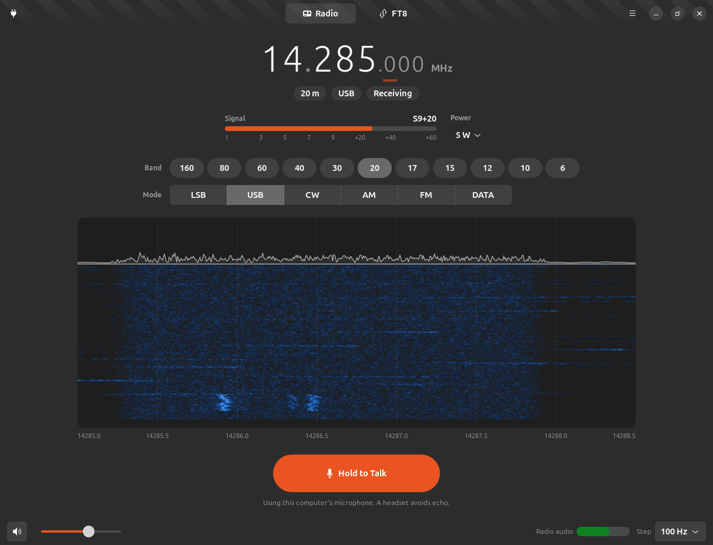
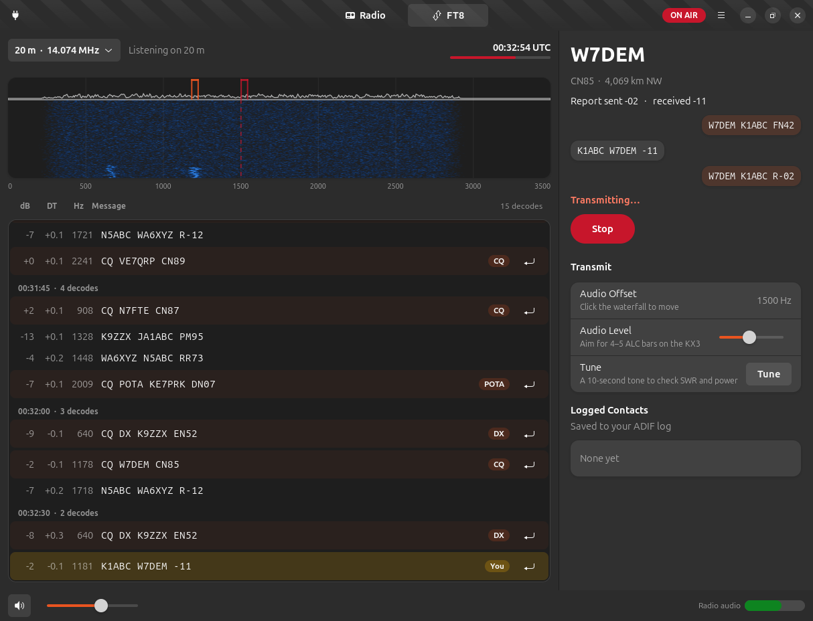
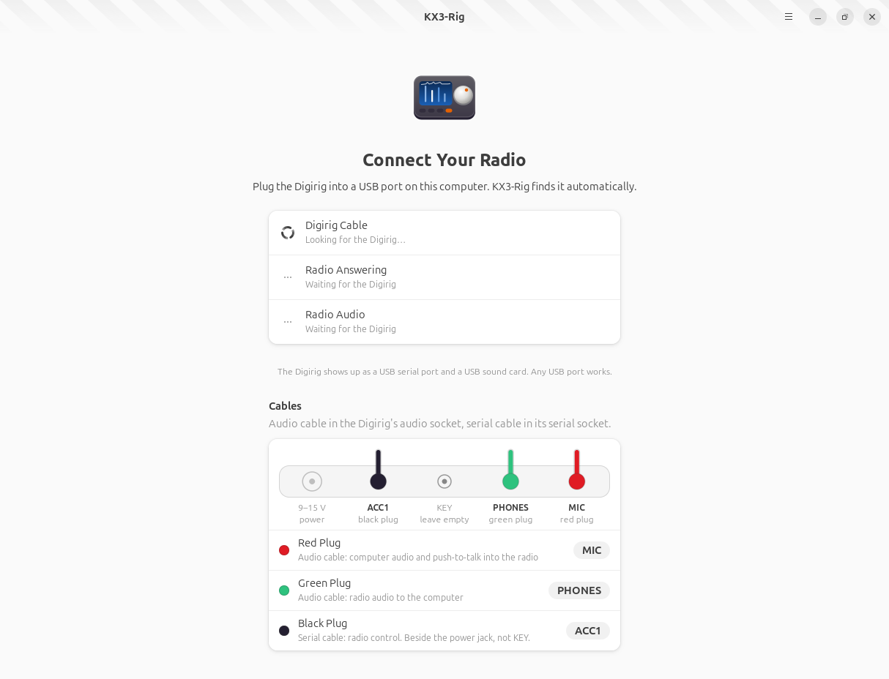

# KX3-Rig

A friendly controller for the **Elecraft KX3**, made for the GNOME desktop. Plug in the radio,
open the app, and start tuning. KX3-Rig shows a big tunable frequency, the band around you as a
waterfall, lets you listen and talk through your computer, and runs FT8 contacts for you.



It is built for one station today: an Elecraft KX3 connected to an Ubuntu laptop through a
**Digirig Mobile** and the Elecraft KX cable set, with a magnetic loop antenna. The design follows
[Bottles](https://usebottles.com): GTK 4 and libadwaita, plain language, no clutter.

## What it does

- **Tune** with a large frequency display. Scroll or drag over any digit to tune that digit,
  click a digit to make it the tuning step, use the arrow keys, or just type a frequency.
- **Pick a band and mode** with one click. Band buttons use the KX3's own band memory, so the
  radio returns to where you last were on each band.
- **See the band** on a waterfall of the receiver's passband, labeled in real frequencies.
- **Listen** on the laptop speakers or a headset. (With the Digirig plugged into PHONES the
  KX3's own speaker is silent, so the app plays the radio for you.)
- **Talk** with Hold to Talk, using the computer's microphone, in SSB, AM, or FM.
- **Work FT8**: one click sets the radio up, decodes appear every 15 seconds, and
  double-clicking a CQ runs the whole contact and logs it in ADIF.
- **Stay legal**: transmit is limited to your license class's privileges (General by default),
  and the app explains why when it can't transmit somewhere.



## Requirements

- Ubuntu 24.04 (GTK 4.14, libadwaita 1.5, PipeWire), Python 3.12
- [WSJT-X](https://wsjt.sourceforge.io/wsjtx.html) installed, for FT8 (tested with 3.0.2; KX3-Rig uses
  its `jt9` decoder and `ft8code` encoder)
- An Elecraft KX3 with its `RS232` menu set to **38400**, a Digirig Mobile (RS-232 build) and
  the Digirig Elecraft KX cable set
- Your account in the `dialout` group, and ModemManager masked (it grabs USB serial ports):

  ```bash
  sudo usermod -aG dialout "$USER"     # then log out and back in
  sudo systemctl mask ModemManager
  ```

## Install

```bash
git clone https://github.com/peterzat/KX3-Rig.git
cd KX3-Rig
./install.sh
```

`install.sh` needs no sudo. It checks for the system packages it relies on (and prints the
`apt install` command if any are missing), creates a virtual environment, installs the
`kx3-rig` command, and adds **KX3-Rig** to Activities.

Try it without a radio: `.venv/bin/kx3-rig --demo` simulates a KX3 and a busy FT8 band,
including stations that answer you.

## Getting on the air

1. **Connect.** Plug the Digirig into any USB port and turn on the KX3 (hold BAND− and
   ATU TUNE for about 2 seconds). Open KX3-Rig. It finds the Digirig and the radio by itself
   and shows a checklist until everything answers.

   

2. **Tune.** Pick a band, pick a mode, and tune. Turn up the volume at the bottom left to hear
   the radio. The **Radio audio** meter at the bottom right should sit in the green; if it
   doesn't, adjust the KX3's AF gain knob.
3. **Talk.** In LSB, USB, AM, or FM, hold **Hold to Talk** and speak. The first time on a
   band, KX3-Rig asks you to confirm and reminds you to retune the AlexLoop. Set the KX3's mic
   gain so its ALC shows about 5 bars while you speak.
4. **FT8.** Open the **FT8** view and press **Tune Radio to FT8** (or choose a band). After a
   cycle or two, decodes appear. Double-click a CQ to answer it, or press **Call CQ**. The app
   sends each message on time, follows the exchange, and logs the contact when it is
   complete. **Stop** (or Esc) ends it immediately.

   Before your first FT8 transmission on a band, press **Tune** in the FT8 view to send a
   10-second tone. Use it to check SWR and to set **Audio Level** so the KX3 shows 4 to 5 ALC
   bars at your chosen power.

## Safety

- The serial port opens with RTS held low (RTS keys the Digirig's push-to-talk), so connecting
  never transmits.
- KX3-Rig only sends a short, fixed list of CAT commands. Commands that could transmit or
  change radio configuration (switch emulation, keying text, menu writes, baud change,
  power-off) are refused before they reach the radio.
- Every transmission has a time limit (2 minutes for voice, one FT8 period for FT8), and
  quitting the app, closing the window, or Esc always unkeys the radio.
- Transmit is blocked outside your license class's privileges, with a reason shown. 60 m is
  receive-only in this version. The power control never asks for more than the maximum in
  Preferences (10 W by default, the AlexLoop's digital limit).
- FT8 contacts are always started by you. When one finishes, the app stops transmitting.

## Troubleshooting

| Symptom | What to check |
|---------|---------------|
| "Connect Your Radio" never finds the Digirig | Is the USB cable seated? `ls /dev/serial/by-id/` should list a `CP2102N` device |
| "Turn On the KX3" while the radio is on | The KX3 `RS232` menu must be 38400. The black cable goes in **ACC1** (next to the power jack), not KEY |
| "Permission Needed" | Add yourself to `dialout` (see Requirements) and log out and back in |
| "Radio in Use" | Another program (often WSJT-X) has the port. Quit it; KX3-Rig connects by itself |
| No FT8 decodes | Is the radio on an FT8 frequency in DATA mode? Is the Radio audio meter green? Is the clock synchronized (`timedatectl`)? |
| Others can't hear you on FT8 | Use Tune and watch the KX3's ALC and power. Raise Audio Level slowly |

## Development

```bash
./run-tests.sh                 # unit tests; no radio needed (WSJT-X tools enable the FT8 round trip)
.venv/bin/kx3-rig --demo       # simulated KX3 and band
.venv/bin/kx3-rig --debug      # verbose logging
```

The code is in `kx3rig/`: `cat.py` (the KX3 command set and allow-list), `radio.py` (the
serial link), `audio.py` (PipeWire streams), `ft8/` (decode, encode, sequencing, logging),
and `ui/` (the interface). Sources for every radio fact are in
[docs/references.md](docs/references.md).

## Credits

FT8 encoding and decoding come from **WSJT-X** by Joe Taylor, K1JT, Steve Franke, K9AN,
Bill Somerville, G4WJS, and the WSJT Development Group. KX3-Rig runs WSJT-X's `jt9` and
`ft8code` programs; its transmit audio follows WSJT-X's published FT8 waveform definition.
The interface design follows [Bottles](https://usebottles.com) and the
[GNOME Human Interface Guidelines](https://developer.gnome.org/hig/).

## License

GPL-3.0-or-later. See [LICENSE](LICENSE).

KX3-Rig is not affiliated with Elecraft or Digirig. Elecraft and KX3 are trademarks of
Elecraft, Inc.
