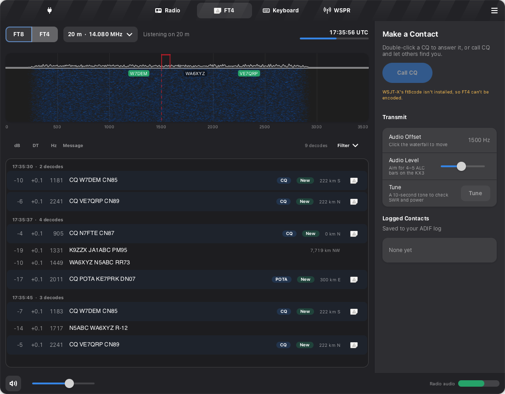
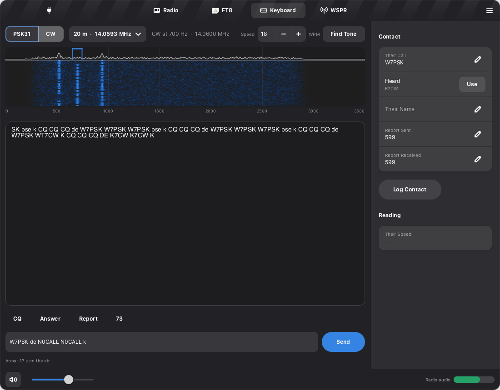
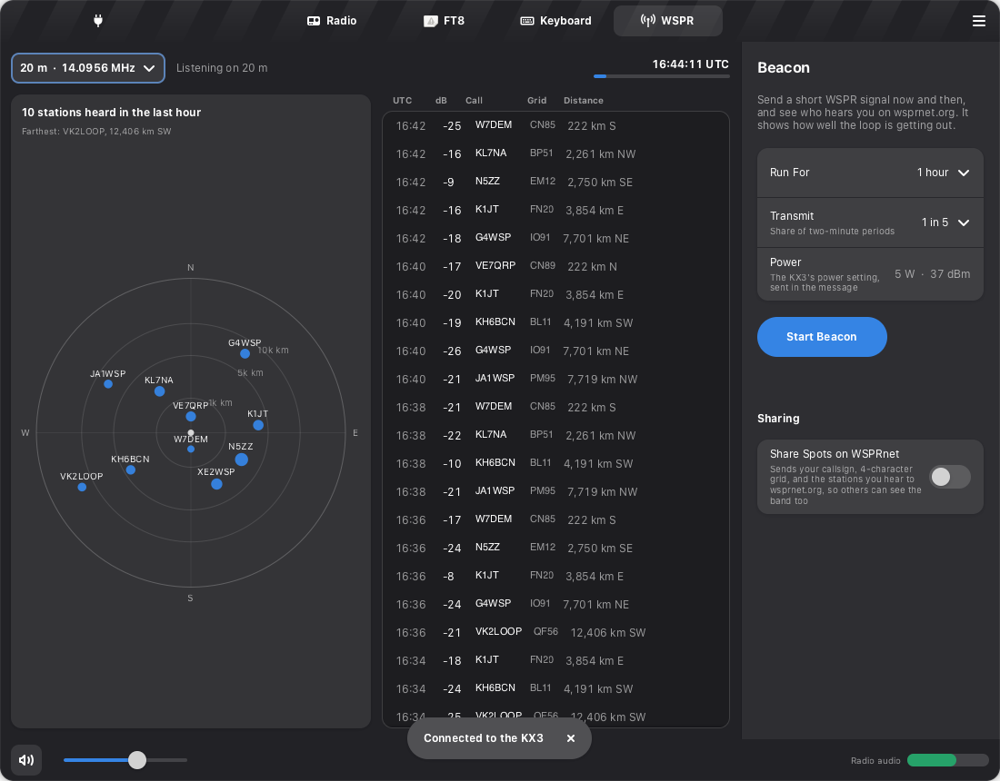

# Digital Modes

KX3-Rig now speaks five modes beyond voice. FT8 and FT4 share the FT8 view. PSK31 and CW
share the Keyboard view. WSPR has its own view, which doubles as the loop's report card. Every
mode sends through the same transmit policy as FT8: license privileges, a time limit, the first
transmission on a band confirmed, and Stop or Esc.

The FT8 improvements are borrowed from [WSJT-X Improved](https://wsjt-x-improved.sourceforge.io)
(DG2YCB). Its author asks that any adapted function credit it with a link; that is what this
page and the README's Credits do. KX3-Rig shares no code with it. Each feature here was
written fresh against stock WSJT-X `jt9`.

## FT8 and FT4

**FT4** is FT8's faster sibling: 7.5-second periods instead of 15, used in contests and on busy
bands. Pick FT8 or FT4 at the top of the view; the tab title follows. The two share everything
but timing and waveform (`ft8/protocol.py`):

| | FT8 | FT4 |
|---|---|---|
| Period | 15 s | 7.5 s |
| Audio starts | 0.5 s | 0.3 s |
| Signal | 8 tones, 50 Hz | 4 tones, about 83 Hz |
| Decoded by | `jt9 -8` | `jt9 -5` |
| Dial, 20 m | 14.074 MHz | 14.080 MHz |

WSJT-X builds an FT4 encoder but does not install it, so KX3-Rig encodes FT4 itself (`ft8/ft4.py`).
FT4 packs messages into the same 77 bits as FT8, so the installed `ft8code` does the packing and
the "would arrive as" check. The rest is ported from WSJT-X: the scrambling, the CRC-14, the
(174,91) LDPC code, the Gray-coded 4-tone mapping with four Costas arrays, and the BT = 1.0 GFSK
waveform. The LDPC port reproduces `ft8code`'s parity bits exactly (FT8 uses the same code). A
round trip through `jt9 -5` is in the test suite and runs where WSJT-X is installed.

**Keeping a fading contact alive** (after WS's Wait and Reply and Wait and Call). With QRP and a
loop, contacts often fade partway through. When a contact runs out of repeats, KX3-Rig stops
transmitting and waits up to 16 periods (4 minutes of FT8) instead of giving up.
- If the other station answers in that time, the contact picks up where they are.
- If they are heard calling CQ or signing off with someone else, KX3-Rig calls them again, up to
  three more times.
- A missed RR73 is sent again when they repeat their roger (this was already the case).
- Each contact waits at most twice. Only a contact you started is ever resumed, so "FT8 contacts
  are always started by you" still holds. Stop ends the wait.

The contact panel shows the countdown: "Waiting for W1AW to come back, 3:20 left."

**The Armed tag** (after WS's yellow "may transmit" warning). An amber Armed tag sits in the
header whenever something may transmit by itself at its next turn: an FT8 contact or CQ in
progress (including a wait), or the WSPR beacon. It turns into the red On Air tag while
transmitting. Its tooltip says what is armed.

**Seeing who you're hearing.**
- Every decode with a grid, or from a station whose grid was heard earlier, shows distance and
  compass direction: "2,636 km E".
- A green New tag marks CQs and calls to you from stations not in your log on this band.
- The latest period's callsigns sit over the waterfall at their frequencies: CQs in green, your
  contact in red, calls to you in amber. Double-click one to answer it.

**Filters** (after WS's filters and False Decodes Reduction). The Filter menu over the decode
list offers three options:
- CQs Only
- Hide Stations in the Log
- Hide Doubtful Decodes (on by default)

Right-click a decode to hide that station for the session. Messages to you are always shown.
"Doubtful" is a post-filter on stock `jt9` output (`ft8/filters.py`). It covers jt9's own
low-confidence mark, plus decodes at -20 dB or weaker whose callsigns don't look like real
ones (an unresolved hash, an impossible shape, or /P with /R). WS does more inside its own
decoder, which KX3-Rig does not ship.

## SWR guard

When a transmission KX3-Rig keyed (voice, FT8, FT4, PSK31, CW, WSPR) reports SWR above 2.5:1 and
it is still above 2.5:1 0.9 s later, KX3-Rig stops transmitting. A notification offers Loop
Tune, and the Loop tag turns to "Tune Loop". This is after WS's SWR stop. A loop drifting off
resonance is the usual cause at this station.

- The transmit meter turns yellow above 1.5:1 and red above 2:1.
- The operator's own TUNE carrier (Loop Tune) is never stopped: their hand is on XMIT.
- It needs the KX3's `SW` command, which arrived in firmware 2.93 or 2.95. The sources disagree;
  see references.md. This radio runs 2.38. Until the firmware is updated with Elecraft's KX3
  Utility, the guard has nothing to read and does nothing.

## PSK31 and CW: done on the computer

The KX3 can decode PSK31, RTTY and CW itself and show the text on its display. KX3-Rig does both
modes in software instead, for control:
- Pick the signal on the waterfall.
- Read every PSK31 signal on the band at once.
- See the conversation on a full screen.
- Keep the radio in one mode for receive and transmit.

Both run in DATA A (upper sideband).

| | Receive | Transmit |
|---|---|---|
| PSK31 | BPSK31 decoder: AFC, squelch, and a signal browser for up to 8 signals (`keyboard/psk31.py`) | Varicode, shaped phase reversals at 31.25 baud |
| CW | Tone detector, adaptive threshold and speed tracking, after fldigi's design (`keyboard/cw.py`) | A keyed tone with 5 ms raised-cosine edges, so no key clicks |

**Sending CW as a tone is legal CW.** A keyed audio tone into a sideband transmitter is emission
J2A, which 47 CFR 97.3(c)(1) includes in its definition of CW. KX3-Rig checks it against CW
privileges (anywhere your class may transmit), over the 100 Hz the tone occupies. Two other
ways were ruled out:
- **Keying with RTS or DTR.** The KX3's ACC1 serial jack carries no RTS or DTR (OM p.5), and the
  Digirig's RTS keys the MIC PTT line.
- **The `KY` command.** It sends text to the KX3's keyer, but the CAT allow-list refuses text
  keying on purpose.

PSK31 is emission J2B, which counts as RTTY (97.3(c)(7)), so it is checked against data
privileges.

**Using it.**
1. Pick PSK31 or CW, pick a band, and press Tune Radio.
   - PSK31 goes to the usual dial (14.070 MHz on 20 m) with signals about 1 kHz up.
   - CW puts the tone on the band's QRP calling frequency (14.060 MHz on 20 m).
2. Click a signal to read it. For CW, Find Tone moves to the strongest one.
3. When a callsign follows "de", the panel offers it as Heard; Use fills Their Call.
4. The macro buttons (CQ, Answer, Report, 73) fill the compose line with your call, theirs, your
   grid and your name. Set your name in Preferences. Edit the line, then press Send.
5. Each message is one transmission, at most 110 s, and is shown in blue in the transcript as it
   goes out.
6. Log Contact writes the contact to the same ADIF log as FT8. CW logs as MODE CW; PSK31 as
   MODE PSK, SUBMODE PSK31.

Measured on synthetic signals:
- PSK31 decodes cleanly down to about -6 dB SNR in 3 kHz, and 8 channels take about 0.5% of one
  core.
- CW decodes cleanly down to about -3 dB at 13-35 WPM, follows speed changes within a few
  characters, and tolerates ±10% hand-keying jitter.
- Real bands (QSB, QRM, AGC) are untested. That is live-test.md section 7.

## WSPR: the loop's report card

WSPR is a beacon mode: a 110-second transmission of call, grid and power that stations around
the world decode and report. It answers "how well is my loop getting out?" with data instead of
anecdotes.

- **Listening:** every two minutes, `wsprd` decodes the last 114 s. The map plots each station
  heard by direction and distance from you (square-root scale, rings at 1,000, 5,000 and
  10,000 km), and the list beside it gives SNR, grid and distance. The heading reads like
  "10 stations heard in the last hour. Farthest: VK2LOOP, 12,476 km SW".
- **Beacon:** choose how long it runs (30 minutes, 1 hour or 2 hours) and how often it transmits
  (1 in 10, 1 in 5 or 1 in 3 periods). It stops by itself when time runs out. The message
  carries the KX3's actual power setting in dBm. Periods are picked by a port of WSJT-X's random
  scheduler, so many stations on one frequency don't collide. WSPR needs a plain callsign (no
  /P) and a 4-character grid.
- **Who heard you:** turn on Share Spots on WSPRnet. Your spots, and the stations that heard you,
  then appear on wsprnet.org. Compare loop positions, or the loop against a wire, there.

WSJT-X installs `wsprd` but not its WSPR encoder, so KX3-Rig encodes WSPR itself
(`wspr/protocol.py`):
- packing
- the K=32 rate-1/2 convolutional code
- the interleaver
- the sync vector

Its symbols match WSJT-X's own C encoder, compiled and run for seven test messages.

## One thing keys the radio at a time

FT8 (or FT4), the WSPR beacon, and a keyboard message each transmit on their own schedule.
Running two at once would interleave transmissions. Each one refuses to start while another is
active, and the reason says which ("Stop the WSPR beacon first."). Smartscan and Loop Tune refuse
too, since they need a quiet radio.

## Privacy

Sharing WSPR spots is the only new network use. It is off until you turn it on. When on, it
sends wsprnet.org the same fields WSJT-X does (Network/wsprnet.cpp):
- your callsign and 4-character grid (never a longer grid)
- your receive frequency
- each spot heard: call, grid, SNR, drift and frequency

It uses plain HTTP, as WSJT-X does. Demo mode never uploads.

## To verify on the radio

These are in [live-test.md](live-test.md), section 7:

- an FT4 round trip (`jt9 -5` decoding KX3-Rig's own FT4, then a contact)
- PSK31 and CW decoding on a real band
- the PSK31 and CW transmit levels and spectra into a dummy load
- a WSPR decode and one beacon transmission into a dummy load
- the SWR guard, after a firmware update
