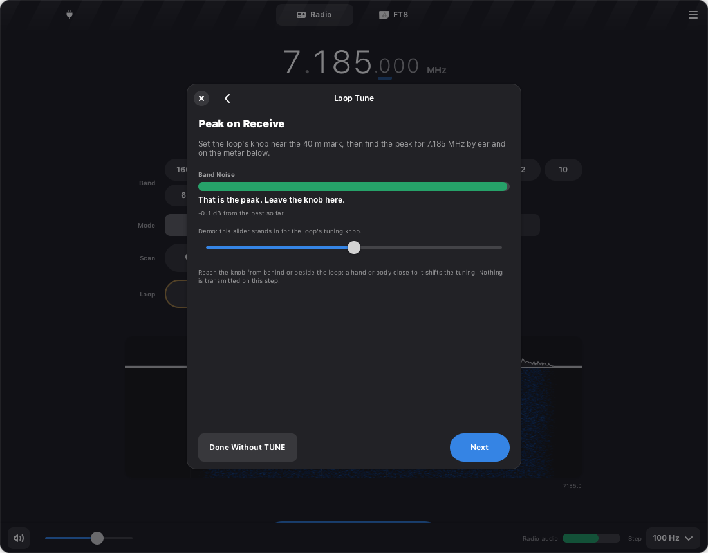
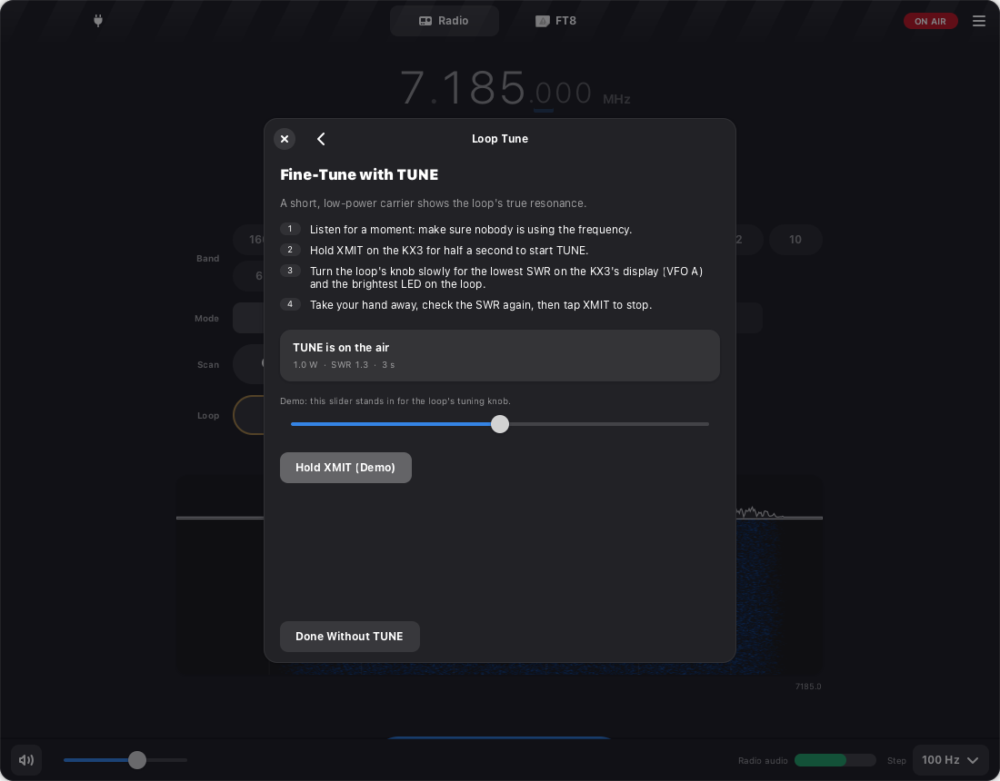
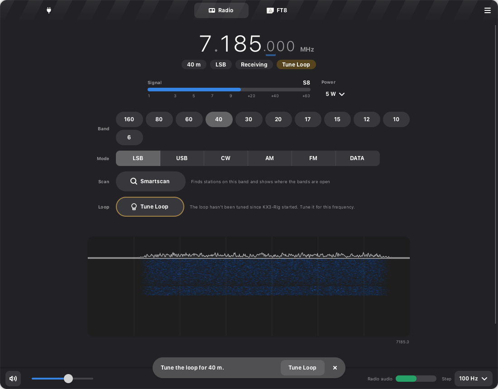

# Loop Tune

The AlexLoop is a small magnetic loop: very efficient for its size, and very narrow. On 40 m it
is usable over about 10 kHz. Move further, or change band, and it must be tuned again by hand.
Loop Tune is a guide for doing that well, and a quiet reminder of when it is due.

## Using it

Press **Tune Loop** in the Radio view's Loop row, or the Loop tag under the frequency.

1. **Before the first tune** (shown once): set two KX3 menu entries. **TUN PWR** to 1.0 W, and
   **ATU MD** to BYP. Hold MENU, turn the small OFS/VFO B knob to the entry, turn the big VFO A
   knob to change it, and hold MENU again to leave.
2. **Peak on receive.** Set the loop's knob near the band's mark and turn it slowly. The band
   noise jumps when the loop comes into resonance. The Band Noise meter shows the level, and the
   guide says when you are on the peak and when you have turned past it. Nothing is
   transmitted.
3. **Fine-tune with TUNE.**
   - Listen to make sure the frequency is clear.
   - Hold XMIT on the KX3 (TUNE).
   - Nudge the knob for the lowest SWR on the KX3's display and the brightest LED on the loop.
   - Take your hand away, check again, and tap XMIT to stop.

   KX3-Rig shows the power and the time on the air. On firmware 2.93 and later it also shows
   the SWR live (this radio runs 2.38, so you read the SWR on the KX3 and tell the guide). It
   warns if TUNE is running above 3 W, which means TUN PWR was left at NOR.
4. **Done.** The loop is recorded as tuned at that frequency. If the SWR stayed above 2:1, the
   guide explains how to re-site the loop first, and gives the ATU as a last resort.

**Done Without TUNE** finishes after the receive peak, for listening only.

**The reminders.** The Loop tag under the frequency reads **Loop Tuned** while the dial is
within a quarter of the loop's 2:1 SWR width of where it was tuned. It turns amber, reading
**Peak Loop**, out to half the width, and **Tune Loop** beyond that, on another band, or before
the first tune after KX3-Rig starts. A band change offers the guide in a notification. Starting
Smartscan on a band the loop is not tuned for opens the guide first and starts the sweep when
it is done. The transmit confirmation says how far the loop is from the dial and offers
**Tune Loop**.

| Band | 2:1 SWR width | Tag turns amber | Retune |
|------|---------------|-----------------|--------|
| 40 m | 10 kHz | 2.5 kHz | 5 kHz |
| 30 m | 15 kHz | 3.75 kHz | 7.5 kHz |
| 20 m | 35 kHz | 8.75 kHz | 17.5 kHz |
| 17 m | 42 kHz (interpolated) | 10.5 kHz | 21 kHz |
| 15 m | 50 kHz | 12.5 kHz | 25 kHz |
| 12 m | 55 kHz (interpolated) | 13.75 kHz | 27.5 kHz |
| 10 m | 60 kHz | 15 kHz | 30 kHz |

160, 80, 60, and 6 m are outside the AlexLoop's 7-30 MHz range. On those bands the tag reads
"No Loop Band" and the guide is off.

## The procedure, and why

Advice on tuning an AlexLoop conflicts, especially about the KX3's internal ATU. Two research
passes read the manufacturer's archived pages, Elecraft's manuals, and about twenty
operators' reports (Elecraft mailing list, QRPer, AmateurRadio.com, AD5X's review). Sources are
in [references.md](references.md#loop-tune-looptune).

**1. Peak on receive noise first.** Every source agrees, including the manufacturer: "Sudden
increase of the band noise indicates that the operator is near the best tuning point." It costs
no transmission, and it gets close enough that the transmit check that follows is brief.

**2. Then a short, low-power carrier, tuned for minimum SWR.** The manufacturer's own procedure
is to key a steady carrier and turn the knob "until the LED shines the brightest. The
transceiver will now show the lowest SWR." This is the "key the mic at a particular time" step
operators describe. The manufacturer says to switch to AM or FM and press PTT. The KX3 does
not need that: holding XMIT is TUNE, a CW carrier in any mode, with the SWR on VFO A (Owner's
Manual p.14).

**3. 1 W for TUNE.** Operators who reported a level used 1 W (AC3B, K2ULR), 2 W, 5 W, or 10 W.
1 W is enough for the KX3's SWR reading. It keeps the RF voltage across the capacitor in the
hundreds of volts instead of thousands. It is also gentle on the KX3's amplifier while the loop
is still off resonance. TUN PWR caps only TUNE, so operating power is unaffected. One caveat:
the LED may be faint at 1 W on 40 m. If so, raise TUN PWR to 2 or 3 W.

**4. ATU in bypass.** This is the main disagreement, and the better-supported side is clear.
- **Against:** the AlexLoop is a resonant transformer, so the loop is the matching network.
  Off resonance it mostly turns power into heat. An ATU can then present a perfect 1:1 to the
  radio while the loop radiates little: "a fairly pricey dummy load" (K6DGW). With ATU MD in
  AUTO, the KX3 also recalls stored matches on its own whenever you transmit after a QSY
  (Owner's Manual p.14), so any key-down can hide the loop's real SWR.
- **For, conditionally:** a few operators use the ATU to trim a residual mismatch after the
  loop is resonant, accepting a little loss (AC7AC, VE3WMB).
- **What the guide does:** BYP by default. The ATU appears only on the "SWR stayed high" page,
  as a last resort after re-siting the loop, followed by a re-peak.

**5. Hands off when checking.** Several operators saw the SWR shift with a hand or body near
the loop. Others saw nothing. Tuning from behind or beside the loop, then letting go and
rechecking, costs nothing either way.

**6. When to retune.** Retune after:
- a band change
- a QSY beyond about half the 2:1 width (the table above)
- moving the loop
- people or objects moving close to it
- a change in weather around an outdoor loop

KX3-Rig can only see the first two, so the tag tracks those. The rest is in the guide's
"Done" text and here.

**What KX3-Rig deliberately does not do:**
- **It never transmits for a loop tune.** CLAUDE.md says the radio is never keyed without the
  operator present and agreeing, and a hand on XMIT is the clearest form of both. It also
  keeps the CAT allow-list free of switch emulation (`SWH16` would start TUNE).
- **It does not set TUN PWR or ATU MD itself.** Menu writes (`MP`) are refused by design: they
  have no range checking and reach settings like TX gain and bias.
- **It does not remember the tuning across restarts.** A portable loop is often packed up or
  moved between sessions, so after a restart the tag asks for a tune.

## How the meter works

The guide reuses Smartscan's noise-floor measurement (`smartscan/detect.py`): each 0.75 s of
PHONES audio becomes a short-time spectrum. The meter reads the noise floor across 300-2800 Hz,
from the quiet moments in each bin, so a station talking in the passband does not lift it. A new
reading arrives every 0.25 s, lightly smoothed (`looptune/meter.py`). The meter keeps the best
level seen:

- **Peak:** within 1 dB of the best
- **Past the peak:** 2.5 dB below the best, after reaching it
- **Searching:** until the level has varied by 3 dB

The KX3's AGC compresses level changes (Owner's Manual p.22), so the real peak may look smaller
than in the demo. The states depend on the shape, not the size, but this needs a check on the
radio.

## Other antennas

A dipole or long wire does not need tuning this way. The guide and the tag are advice, never a
lock: nothing is refused because the loop is "untuned". If a wire becomes a regular, the
Antenna preference sketched in [smartscan.md](smartscan.md#other-antennas) would also hide the
Loop row and use the ATU.

## To verify on the radio

These are in [live-test.md](live-test.md), section 6:

- whether `IF`/`TQ` report transmit during front-panel TUNE (the PR documents TQ for PTT and
  pseudo-transmit, not TUNE)
- what `PO` reads at TUN PWR 1.0 W
- how large the receive peak looks through AGC on each band
- whether the LED is visible at 1 W on 40 m
- how far a hand on the knob shifts the SWR at this station
